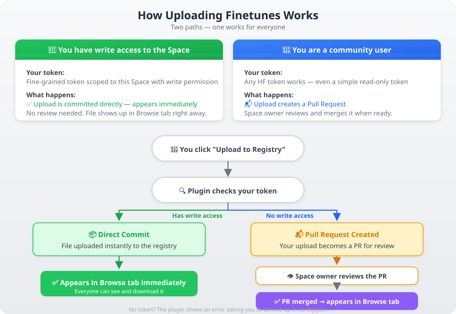

# Wan2GP Finetune Manager Plugin v3.7.3 🧪

> ⚠️ **This is a test version!** The plugin is still in active development. If you find bugs, have suggestions, or run into any issues, please let me know:
> - **GitHub Issues**: [Open an issue](https://github.com/GKartist75/Wan2GP-finetune-manager/issues)
> - **Wan2GP Discord**: [Post in the Plugins Catalog — Wan2GP Finetune Manager](https://discord.com/channels/1361676211817939125/1527049874699325490)

Community finetune registry plugin for Wan2GP. Browse, load, create, improve, and upload finetune JSONs with an integrated Create/Edit tab that matches the built-in Finetune Editor (Alt+F).

> **Latest version: v3.7.3** — [GitHub](https://github.com/GKartist75/Wan2GP-finetune-manager) | [HF Registry](https://huggingface.co/spaces/GKartist75/wan2gp-finetunes) | [User Guide](./user-guide.html)

## Security and trust — verify every URL yourself

The registry is **community-contributed**. The plugin validates the
recipe structure and the URL policy (HTTPS only, no credentials, no local or
private-network hosts), and it refuses bare filenames, local paths and embedded
HTML. Those checks reduce obvious risks; they **do not** prove that the uploader
is trustworthy or that the file behind a URL is what it claims to be.

Before downloading anything:

- Open the JSON/details and check **every URL yourself**. It must start with
  `https://` and the host must be one you expect, normally `huggingface.co`,
  `civitai.com` or `civitai.red`.
- Check the **repository, path and filename**. Re-uploads, lookalike accounts and
  typosquatted hosts can carry the same display name and description.
- Prefer entries with a **known SHA-256**, and verify it after download where the
  source publishes one. A valid hash proves the bytes match; it does not prove
  the bytes are safe.
- Treat `.ckpt`, `.pt`, `.pth`, `.bin`, `.gguf` and `.safetensors` files from
  strangers as executable code until proven otherwise. Do not load a model just
  because it appears in this registry.
- Never put your Hugging Face or CivitAI token in a finetune JSON or a shared
  recipe. Tokens belong only in the local, gitignored `config.json`.
- Report malicious or broken entries through
  [GitHub Issues](https://github.com/GKartist75/Wan2GP-finetune-manager/issues).

**This plugin is a browser and editor, not an antivirus or a signature authority.
Always check yourself.**

## Features

| Tab | Functionality |
|---|---|
| **Browse** | Refresh registry, search by name/description/author/ID, filter by **model family**, architecture or tag, cards grouped under family headings, click cards for JSON details, validate URLs, download locally, improve/create variant |
| **Create / Edit** | Full tabbed form (URLs, LoRAs, Resolutions, Help, Prompt Enhancer, Settings) with Auto-ID, Markdown toolbar, Creator/Editor mode, Import/Export, URL validation, pre-download, two-step delete. Architecture choices come from the running Wan2GP host and are labelled by family. All URL/LoRA fields include a **Browse 📂** button for native file selection. |
| **Local** | Visual card browser grouped by family, search and family/architecture filters, load & switch, delete, export, import .json with preview, upload to registry |
| **CivitAI** | Search CivitAI by query/type/base model, on `civitai.com` or its adult front-end `civitai.red`, browse results with version details, pick a version from the result dropdown, then fill its URL (routes to LoRA or main checkpoint automatically) |
| **Pack** | Optional curated adult pack catalog: 18+ gate plus six sub-tabs. **Catalog** (one row per item with its live state; download/recipe/gallery/delete for just that item), **Find & Add** (search or browse HuggingFace and CivitAI, inspect files, add one as a LoRA or checkpoint, or add by link), **LoRAs**, **Checkpoints and recipes**, **CivitAI** (release selection and downloads), **Updates** (offline compare, live online check, apply pins, download the pinned bytes). Off by default. |

## Pack recipes and assets

The plugin understands Wan2GP's pack recipe conventions, so a recipe written by
the desktop launcher (or shared by another user) opens with the same asset paths
Wan2GP itself will use:

- `|subfolder` and `|%lora_dir` suffixes are parsed as install instructions, not
  as part of the URL. Traversal outside the model/LoRA roots is rejected.
- LoRAs default to the architecture's LoRA collection; `|%lora_dir` pins that
  explicitly. Checkpoints, text encoders, VAEs, preloads, second-phase URLs and
  optional assets are all inventoried.
- `=recipe_id` references are followed without being counted as files, and
  `adultpack_*` / plain ids resolve to each other as aliases.
- **Assets** and **Download missing** use the resolved destination, so downloads
  land where Wan2GP scans them. The summary is re-read from disk after transfers.
- The Local tab marks curated pack recipes with an **Adult Pack** badge.
- The **Pack** tab is the native Gradio home for the curated catalog and is off
  by default. Its state lives in `pack_state.json`; items you add yourself live in
  `adult-pack-custom.json` and behave exactly like curated ones.
- **Catalog** reads the same status the actions use, so the table, the detail
  panel and what **Download this** / **Delete this** will touch can never drift.
- **Find & Add** inspects a HuggingFace or CivitAI result before you commit to a
  download: file kind, size, HIGH/LOW half and SHA-256, plus the version list for
  CivitAI. Adding is one file at a time, as a LoRA or a checkpoint.
- **Updates** keeps acceptance and download separate: **Check online** records the
  live hash/size, **Apply selected** pins them, and only then does **Download
  selected** fetch those exact bytes. CivitAI releases are pinned to the version
  you reviewed instead of "latest".

The desktop launcher installs this plugin by default and leaves pack management
here; it keeps only a small companion card in **Manage -> Plugins**.

## Install

### Easiest — Install from URL (in Wan2GP)
1. Open Wan2GP → **Plugins** tab
2. Click **Install from URL** (expand the section)
3. Paste the GitHub URL into the **GitHub URL** field:

   ```
   https://github.com/GKartist75/Wan2GP-finetune-manager
   ```

4. Click **Download and Install from URL**
5. Restart Wan2GP when prompted

### Alternative — Manual
Clone or download into `plugins/finetune_manager`, then restart Wan2GP.

## Registry Token Setup

A token is only needed to **upload** finetunes — browsing, searching, and downloading from the registry work without one.

### Quick Start (1 minute)

1. Get a **User Access Token (read)** at [huggingface.co/settings/tokens](https://huggingface.co/settings/tokens)
   - Click **New token** → **read** → give it a name → **Create token**
   - A read-only classic token is all you need — you don't need write access

2. Create `config.json` in the plugin folder (`plugins/Wan2GP-finetune-manager/config.json`):

   ```json
   {"registry_token": "hf_YOUR_TOKEN_HERE"}
   ```

   Replace `hf_YOUR_TOKEN_HERE` with your actual token. See [`config.example.json`](./config.example.json).

3. Done! The plugin picks it up automatically after restart.

**Alternative:** Run `huggingface-cli login` in your terminal instead.

> ⚠️ `config.json` is gitignored — your token stays local and will never be committed.
> 💡 No token? Skip steps 1-3. You can still use Browse, Create/Edit, Local, and CivitAI tabs. Upload will show a clear error asking you to set up your token.

#### Optional: CivitAI mature content and the adult site

CivitAI hides mature models unless they are asked for. Tick **Include NSFW** in the CivitAI tab, or make it the default in `config.json`:

```json
{"registry_token": "hf_YOUR_TOKEN_HERE", "civitai_nsfw": true}
```

`civitai_nsfw` defaults to `false` when the key is absent, so an existing `config.json` keeps the previous behaviour.

The **Site** dropdown in the CivitAI tab chooses between `civitai.com` (standard) and `civitai.red` (its adult front-end). Both serve the same catalogue — same models, same ids, and *Include NSFW* is what actually includes mature models on either one — but the site decides which host the download links filled into Create/Edit belong to, and `civitai.red` is the front-end that still works where the standard site gates mature content. The default can be set in `config.json`:

```json
{"civitai_site": "civitai.red"}
```

Mature files are behind a login on both hosts, so an anonymous download of one fails no matter which site you pick. To make those downloads work — and to raise the anonymous rate limit — add your CivitAI API key ([civitai.com](https://civitai.com) → Account settings → API Keys):

```json
{"civitai_api_key": "your_civitai_api_key"}
```

The key is sent as an `Authorization: Bearer` header for searches, and appended as `?token=…` to the download URLs the plugin fills in (Wan2GP's downloader fetches the URL itself and cannot send headers, which is why the query form — the one CivitAI documents for download tools — is used there). The key is never attached to any non-CivitAI host.

See [`config.example.json`](./config.example.json).

### How It Works



The plugin automatically detects your access level:

| **User Access Token (read)** | Pull Request created at [discussions](https://huggingface.co/spaces/GKartist75/wan2gp-finetunes/discussions) | 📬 Owner reviews and merges |
| **No token** | Upload blocked with help message | ❌ Follow Quick Start to set one up |

**What happens when you upload:**
1. The plugin uses your token to submit the finetune
2. Since you don't have write access, it automatically creates a **Pull Request**
3. You'll see a confirmation with a link to the PR
4. The Space owner reviews your submission and merges it
5. Once merged, your finetune appears in everyone's Browse tab

When the upload is committed directly (Space owner), the plugin also refreshes `families.json`, the generated family catalogue used by the static registry page to group cards by Wan2GP model family.

## Files

```
wan2gp-finetune-manager/
├── __init__.py
├── config.example.json  # Registry token template (copy to config.json)
├── config.json          # Registry token (gitignored — create from config.example.json)
├── plugin.py            # Plugin entry point and UI logic
├── plugin_info.json     # Plugin metadata v3.7.2
├── fm_security.py       # URL policy, safe fetching, size limits
├── fm_assets.py         # Pack recipe/asset resolution
├── fm_pack.py           # Pack catalog, downloads, updates
├── CHANGELOG.md         # Version history
├── user-guide.html      # Friendly walkthrough of all features
├── hf_space/            # Static HF registry page (uploaded to the Space)
│   ├── index.html       # Family-aware registry browser
│   ├── index.json       # Machine-readable registry index
│   └── families.json    # Generated family catalogue + architecture map
├── tests/               # Asset, pack and security tests
└── .gitignore
```

## Troubleshooting

### `Could not load metadata for plugin Wan2GP-finetune-manager: No module named 'Wan2GP-finetune-manager.plugin'`

Wan2GP reads `plugin_info.json` from the plugin folder first and otherwise imports `<plugin folder>.plugin` (`shared/utils/plugins.py`). This message means one of the required files is missing from the folder Wan2GP scans — a partial clone or copy, or a `__pycache__` left behind after the source file was deleted. It is printed once per plugin scan, so it repeats on every startup.

Check that `<Wan2GP>/plugins/Wan2GP-finetune-manager` contains all three:

```
plugin.py           # required — the plugin entry point
plugin_info.json    # required — metadata (name, version, type)
__init__.py         # required — makes the folder a package (may be empty)
```

Recover a git checkout, then clear the stale bytecode and restart Wan2GP:

```powershell
cd <Wan2GP>/plugins/Wan2GP-finetune-manager
git restore --source=HEAD -- plugin.py plugin_info.json __init__.py
Remove-Item -Recurse -Force .\__pycache__
```

A `__pycache__/plugin.cpython-*.pyc` cannot substitute for `plugin.py` — the loader needs the source file beside it.

## What's New in v3.7.3

- **Registry wording** — the registry is described as community-contributed. The security guidance is unchanged: verify every URL, host and file before downloading.

## What's New in v3.7.2

- **Security and trust disclaimer** — the README and user guide now state plainly that the registry is community-contributed and that URL validation is not a safety guarantee. Check the host, repository and file yourself before downloading.
- **Registry index refreshed** — `index.json` now lists the 14 finetunes that actually exist instead of three removed recipes. The live Space page is also up to date with the v3.7.1 hardening.
- **Files section corrected** — the README now lists the current modules, tests and Space files.

## What's New in v3.7.1

- **Security hardening** — one allowlisted HTTPS URL policy for registry, CivitAI and downloads; redirects cannot escape the allowlist; auth headers are stripped across hosts; tokens cannot be embedded in uploads. Registry recipes are validated and rejected if they contain bare filenames, local paths, dangerous schemes or embedded HTML. The HF Space page escapes attributes, caps JSON size and encodes file IDs. See `CHANGELOG.md` for details.

## What's New in v3.6.9

- **Model-family browsing** — finetunes are now categorised with Wan2GP's own family system (LTX-2, MiniMax H3, Wan2.2, Wan2.1, Flux 2, Qwen Image, Krea 2, ...). Browse and Local have a **Model family** filter, cards are grouped under family headings with counts, and every card shows its family and architecture. The Architecture filter narrows to the selected family.
- **Family-aware editing** — the Create/Edit Architecture dropdown is filled from the running Wan2GP host and labelled like `LTX-2 - ltx2_22B`, so you can see both the base type and its family.
- **Family-aware registry page** — the HF Space registry now groups cards by family and filters the architecture list to the chosen family. `families.json` is generated from the host and refreshed on every upload.
- **Mismatch warnings** — a finetune whose name points at another family (for example a Z-Image name saved with `architecture: "t2v"`) gets a `looks like Z-Image` badge; the file is never rewritten silently.

## What's New in v3.6.8

- **Complete plugin files restored** — `plugin.py`, `plugin_info.json`, `README.md`, `CHANGELOG.md` and `user-guide.html` had gone missing from the working tree, which made Wan2GP print `Could not load metadata for plugin Wan2GP-finetune-manager: No module named 'Wan2GP-finetune-manager.plugin'` on every plugin scan. All five files are back and the plugin reports v3.6.8 in the Plugins tab.
- **Troubleshooting section** — the README now explains that startup message, lists the files the loader needs, and shows how to recover a partial checkout.
- **No functional changes** — plugin behaviour is identical to v3.6.7.

## What's New in v3.6.7

- **Editor round-trips are lossless again** — clearing a URL, LoRA, custom resolution, solver, or prompt field now removes it from the saved finetune; custom `model.resolutions` are no longer replaced by the top-level default resolution.
- **Model references stay scalar** — `URLs`, `URLs2`, `text_encoder_URLs`, `VAE_URLs`, `preload_URLs`, and `loras` keep the single-string model-id form Wan2GP resolves. LoRA step syntax such as `1,1.1;0` is preserved, and the top-level `activated_loras` copy stays in sync with `model.loras`.
- **CivitAI fixes** — DoRA/LoCon results now fill the LoRA field, and the version picker uses a real dropdown plus **Fill Selected**; the old per-card "Use" buttons depended on scripts that Gradio does not execute.
- **Safer file and upload handling** — uploads refuse URLs containing a CivitAI `token=` (so the API key is never published); registry downloads, variants, and local uploads are schema-validated; imports no longer silently overwrite; Delete also removes the matching settings file.
- **UI fixes** — the Architecture filter is populated from the registry (and accepts custom values), the Local **Export JSON** button is inside the Local tab, and card selection is escaped correctly.

## What's New in v3.6.6

- **`civitai.red` support** — CivitAI's adult front-end is now a **Site** dropdown in the CivitAI tab (`civitai.com` / `civitai.red`). Both hosts serve the same catalogue — same models, same ids — so the choice decides which host the download links filled into Create/Edit belong to, and covers regions where the standard site gates mature content. Set the default with `"civitai_site"` in `config.json`.
- **Optional CivitAI API key** — `"civitai_api_key"` in `config.json` is sent as `Authorization: Bearer` for searches and appended as `?token=…` to the download URLs the plugin fills in, which is what makes mature (login-gated) files downloadable. It is never attached to a non-CivitAI host.

## What's New in v3.6.5

- **CivitAI filters that actually work** — Type and Base Model now read CivitAI's live `/api/v1/enums`, so Wan Video 2.1/2.2, LTXV 2.3/2.5, MiniMax H3, Hunyuan Video, Qwen, Z-Image, Krea 2 and Flux.2 are selectable (with a built-in fallback list when offline); filtered searches merge three concurrent lookups instead of coming back empty; requests retry dropped connections, 5xx and 429; and **Include NSFW** reveals mature models (`"civitai_nsfw": true` makes it the default). Contributed by HateTM — [PR #1](https://github.com/GKartist75/Wan2GP-finetune-manager/pull/1).

## What's New in v3.6.4

- **Malformed finetune files no longer crash the plugin** — loading a corrupt, empty or schema-invalid local/registry finetune now shows a clear "Cannot load 'X': …" message and a red ⚠ card in the Local tab, instead of a deep traceback.

## What's New in v3.6.3

- **In-token setup guide** — when no HF token is configured, a yellow warning banner appears at the top of the plugin with step-by-step instructions and a **📂 Open plugin folder** button that opens Explorer directly to the plugin folder
- **Better error messages** — upload errors now show the exact file path and step-by-step token setup instructions instead of a terse "No HF token available"
- **Path traversal fix** — `_write_settings_for_wan2gp` now sanitizes the finetune ID before writing to disk, preventing `../../` escape attacks
- **Stale cache fallback** — registry fetch failures serve cached data for up to 5 minutes instead of returning empty results
- **Dead code removal** — removed orphaned `_loras_from_json` (NameError if called), `_loc_list`, `_clean_surrogates`/`_clean_tuple`
- **Improved setup experience** — `config.example.json` now includes inline instructions; `fix_registry_loras.py` uses script-relative paths instead of hardcoded absolute paths
- **Various cleanups** — unused parameters removed, event handler deduplication, module-level imports made lazy where appropriate

## What's New in v3.6.2

- Version bumped to 3.6.2

## What's New in v3.6.1

- **LoRAs now load correctly from finetunes** — `model.loras` is promoted to top-level `activated_loras` when writing the Wan2GP settings file, so `load_settings_from_file` finds and applies them. The Gradio UI is also force-refreshed to populate the LoRA tab after switching.
- **preload_URLs accepts bare model names** — built-in model identifiers like `ltx2_22B_distilled` no longer trigger a false "needs full https:// URL" validation error.
- **Registry finetunes updated** — `EasyWan22_FastMix` now has top-level `activated_loras` in the HF Space registry.

## What's New in v3.5.1

- **Community uploads via PR** — users without write access to the registry Space can now upload. The plugin auto-detects permission issues and creates a Pull Request instead of failing. [Community Tab](https://huggingface.co/spaces/GKartist75/wan2gp-finetunes/discussions)
- **Security** — `config.json` is now gitignored. Tokens stay local, never in git.
- **Config template** — `config.example.json` added as a safe template.

## What's New in v3.5.0

- **User guide** — new `user-guide.html` with a friendly, visual walkthrough of all features and common workflows
- **Bug fixes** — textbox fields no longer get cleared when changing dropdown selections; `finetune_source_model` no longer gets overwritten on improve
- **Import preview** — selecting a .json file for import now shows its contents before you commit
- **Registry cache** — 30-second TTL cache prevents redundant fetches on rapid Refresh clicks
- **Dark mode** — card HTML uses CSS custom properties instead of hardcoded colors, adapting to Wan2GP's theme
- **Round-trip stability** — key ordering preserved when editing and re-uploading finetunes
- **Code deduplication** — shared URL/LoRA key lists and card HTML builder extracted to module-level, removing ~150 lines of duplicated code

## Credits

- **[HateTM](https://github.com/HateTM)** — the CivitAI filter work in [PR #1](https://github.com/GKartist75/Wan2GP-finetune-manager/pull/1): live Type/Base Model enums, the merged filtered search, request retries, and the Include NSFW option. The v3.6.6 `civitai.red` site selector and API-key support are built on top of it.

## 🔗 Links

- **GitHub**: https://github.com/GKartist75/Wan2GP-finetune-manager
- **HF Registry**: https://huggingface.co/spaces/GKartist75/wan2gp-finetunes — browse the finetune registry live with search/filter and click-to-expand JSON details
- **User Guide**: [user-guide.html](./user-guide.html) — visual walkthrough of all features
